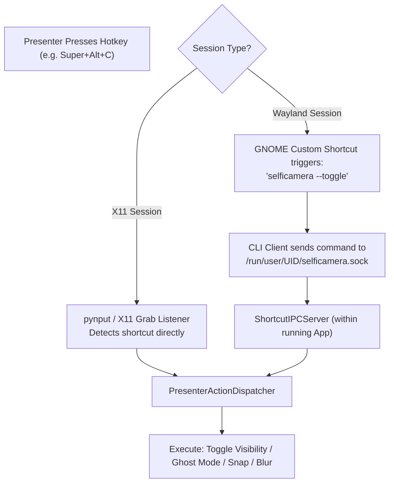

# SelfiCamera System Architecture & Technical Specification

**Document Version:** 1.0.0  
**Status:** Approved / Authoritative Architecture Blueprint  
**Author:** Chief Technology Officer (CTO)  
**Target Platform:** Ubuntu Linux 24.04 / 26.04 LTS (Wayland & X11)  
**Runtime:** Python 3.12+ (isolated virtual environment via `uv`)  

---

## 1. System Architecture Overview

SelfiCamera is an ultra-lightweight, zero-bloat, offline desktop circular presenter camera overlay for Ubuntu Linux. It is architected around decoupled, concurrent subsystems communicating through thread-safe Qt signals and standard POSIX primitives.

### 1.1 Architectural Flow Diagram

```mermaid
flowchart TD
    subgraph Hardware & OS Layer
        V4L2["Linux V4L2 Device (/dev/video*)"]
        PipeWire["PipeWire / PulseAudio (Default Mic)"]
        Display["Wayland Compositor / X11 Server"]
        IPC_Socket["Unix Domain Socket (/run/user/UID/selficamera.sock)"]
    end

    subgraph Acquisition & Input Threads
        CamWorker["CameraCaptureWorker (QThread)<br/>Non-blocking V4L2 Frame Polling<br/>Atomic Frame Dropping (Queue Depth=1)"]
        AudioWorker["AudioMonitorWorker (QThread)<br/>sounddevice / PortAudio Stream<br/>RMS Energy & Attack-Decay Envelope"]
        IPCDaemon["ShortcutIPCServer (QThread)<br/>Unix Domain Socket Listener<br/>CLI Command Parser"]
        X11Grabber["X11ShortcutListener (pynput thread)<br/>Active when XDG_SESSION_TYPE=x11"]
    end

    subgraph Processing Pipeline Engine
        FrameProc["FrameProcessor (Pure CPU SIMD/NumPy/OpenCV)<br/>1. Horizontal Flip (Mirror)<br/>2. Auto-Light Boost (Adaptive Gamma LUT)<br/>3. Offline Segmentation (ONNX Runtime)<br/>4. Multi-Tier Bokeh Blur & Alpha Blending"]
    end

    subgraph Presentation & UI Layer (Main Qt Thread)
        OverlayWin["OverlayWindow (Frameless Circular Viewport)<br/>- Anti-aliased Circular Clipping<br/>- Soft Drop Shadow Canvas<br/>- Dynamic Voice Aura Glow Border<br/>- Drag-to-move & Scroll-Resize<br/>- Corner Snapping Engine"]
        HUD["AutoHidingHUD (Overlay Controls)<br/>- Mirror Toggle<br/>- Blur Level Step<br/>- Ghost Mode Toggle<br/>- Settings / Close<br/>- Opacity Animation (Enter/Leave)"]
        Tray["AppIndicator / QSystemTrayIcon<br/>- Device & Resolution Selector<br/>- Mode Toggles & Exit"]
    end

    subgraph Configuration & State
        ConfigMgr["ConfigManager (Atomic JSON Storage)<br/>~/.config/selficamera/config.json"]
    end

    V4L2 -->|Raw Frames BGR| CamWorker
    PipeWire -->|PCM Audio Buffers| AudioWorker
    IPC_Socket -->|CLI Action Events| IPCDaemon
    Display -->|Native Input Events| OverlayWin

    CamWorker -->|Raw Frame Signal| FrameProc
    FrameProc -->|Processed BGRA QImage| OverlayWin
    AudioWorker -->|Voice Energy Signal [0.0 - 1.0]| OverlayWin
    IPCDaemon -->|Shortcut Action Signals| OverlayWin
    X11Grabber -->|Shortcut Action Signals| OverlayWin

    OverlayWin <--> HUD
    Tray -->|Control Actions| OverlayWin
    ConfigMgr <-->|Persist / Load State| OverlayWin
```

---

## 2. Performance & Latency Budget

To deliver a fluid presenter experience over fullscreen IDEs, video calls, or screen recordings, SelfiCamera enforces a strict per-frame processing budget of **< 30.0 milliseconds** (enabling solid 30 FPS with headroom for 60 FPS) and **< 5% CPU utilization** on standard 4-core+ x86_64 Ubuntu systems.

### 2.1 Per-Frame Latency Breakdown (720p 1280x720 Capture)

| Processing Stage | Target Latency | Optimization Strategy |
| :--- | :--- | :--- |
| **1. V4L2 Camera Capture** | 1.0 - 2.5 ms | Native `V4L2` ioctl via OpenCV `CAP_V4L2` or direct memory mapped buffers; non-blocking poll in background worker. |
| **2. Horizontal Mirror** | 0.2 - 0.5 ms | Continuous contiguous memory flip via `cv2.flip(frame, 1)`. |
| **3. Auto-Light Boost** | 0.6 - 1.2 ms | Downsampled luminance estimation (1/8 scale) + 256-byte precomputed Look-Up Table (`cv2.LUT`). |
| **4. Segmentation Inference** | 4.0 - 8.0 ms | Ultra-lite MediaPipe Selfie Segmentation ONNX model (~1.5 MB), fixed 256x256 float32 input, vectorized ONNX Runtime CPU execution. |
| **5. Bokeh Blur & Blending** | 2.5 - 4.5 ms | 1/4 resolution downsample-blur-upsample photographic bokeh trick + vectorized alpha blend. |
| **6. QImage Conversion & Paint** | 1.5 - 3.0 ms | Zero-copy `QImage` pointer wrapping `numpy.ndarray.data` + hardware-accelerated `QPainter` draw. |
| **Total Pipeline Latency** | **9.8 - 19.7 ms** | **Well within the 30.0 ms target budget (< 66% of budget utilized).** |

### 2.2 Latency Prevention & Memory Safeguards
1. **Atomic Depth-1 Queue**: If the rendering thread or processing thread falls behind, the capture worker immediately discards old frames. Only the most recent frame is retained. There is **zero queue buildup**, ensuring no lag accumulation over long streaming sessions.
2. **Zero In-Loop Heap Allocations**: Frame buffers, LUT tables, and intermediate scaling matrices are pre-allocated during pipeline initialization or resized only upon camera resolution change.
3. **Pure CPU Offline Execution**: No CUDA/OpenCL context switching latency or GPU driver mismatch crashes.

---

## 3. Detailed Subsystem Specifications

### 3.1 Subsystem 1: Frameless Circular Overlay & Rendering (`selficamera.ui.overlay`)

#### 3.1.1 Window Structure & Canvas Geometry
The overlay window is a frameless, transparent `QWidget` sized to accommodate the circular camera viewport plus an outer boundary margin for the soft Gaussian shadow and voice aura glow.

$$\text{Window Width} = \text{Diameter} + 2 \times \text{Shadow Margin}$$
$$\text{Window Height} = \text{Diameter} + 2 \times \text{Shadow Margin}$$

- Default `Shadow Margin`: 16 px.
- Preset Diameters:
  - **Small**: 160 px (Window: 192x192 px)
  - **Medium (Default)**: 260 px (Window: 292x292 px)
  - **Large**: 380 px (Window: 412x412 px)

#### 3.1.2 Qt Window Flags & Wayland/X11 Attributes
```python
# Essential flags for floating presenter overlay
flags = (
    Qt.WindowType.FramelessWindowHint |
    Qt.WindowType.WindowStaysOnTopHint |
    Qt.WindowType.Tool  # Prevents cluttering the GNOME alt-tab dock
)
self.setWindowFlags(flags)
self.setAttribute(Qt.WidgetAttribute.WA_TranslucentBackground, True)
self.setAttribute(Qt.WidgetAttribute.WA_NoSystemBackground, True)
```

#### 3.1.3 High-Precision Rendering Pipeline (`paintEvent`)
The painting sequence executes cleanly in `paintEvent(QPaintEvent)`:
1. **Drop Shadow Pass**: Draw outer soft Gaussian shadow using an annular/radial gradient or pre-rendered blurred shadow pixmap centered at `(cx, cy)` with radius `r = diameter/2 + shadow_margin`.
2. **Video Clip Pass**: 
   - Define circular clipping path:
     ```python
     path = QPainterPath()
     path.addEllipse(shadow_margin, shadow_margin, diameter, diameter)
     painter.setClipPath(path)
     ```
   - Center-crop the aspect-ratio locked video feed into the $1:1$ circular square.
   - Draw the processed `QImage` scaled smoothly with `Qt.TransformationMode.SmoothTransformation`.
3. **Voice Aura Ring Pass**:
   - Disable clipping (`painter.setClipping(False)`).
   - Draw the outer border ring with a dynamic pen width (2.5px to 6.0px) and reactive glow color gradient reflecting the microphone energy.
4. **Border Stroke Pass**:
   - Subtle semi-transparent crisp inner ring (`#ffffff` with 20% alpha) to separate camera feed from the background.

#### 3.1.4 Mouse Interaction & Dynamic Resizing
- **Drag-to-Move**: Tracks `mousePressEvent` global position delta and calls `self.move(new_pos)` during `mouseMoveEvent`. Automatically clamps coordinates within active virtual screen geometry (`QGuiApplication.primaryScreen().availableGeometry()`).
- **Scroll-to-Resize**: `wheelEvent(QWheelEvent)` detects vertical scroll steps. Scrolling up smoothly steps to the next larger preset diameter ($160 \rightarrow 260 \rightarrow 380$); scrolling down steps smaller. Transitions use `QPropertyAnimation` over the `diameter` property with `QEasingCurve.OutCubic` (duration: 180ms).
- **Corner Snapping**: Triggered via shortcuts (`Super+Alt+1..4`), calculating exact screen boundaries minus a 24px screen margin:
  - `Corner 1 (Top-Left)`: `(margin, margin)`
  - `Corner 2 (Top-Right)`: `(screen_w - win_w - margin, margin)`
  - `Corner 3 (Bottom-Left)`: `(margin, screen_h - win_h - margin)`
  - `Corner 4 (Bottom-Right)`: `(screen_w - win_w - margin, screen_h - win_h - margin)`

#### 3.1.5 Click-Through Ghost Mode
When Ghost Mode is enabled:
- Qt attribute `Qt.WidgetAttribute.WA_TransparentForMouseEvents` is set to `True`.
- On X11, an empty input region is committed using `setMask(QRegion())` or `XShapeCombineRectangles`.
- On Wayland, empty input surface region is requested via `wl_surface_set_input_region(surface, NULL)`.
- Mouse clicks pass completely through to underlying IDEs, editors, and terminals.
- Exit from Ghost Mode is triggered via the global shortcut (`Super+Alt+X`) or the System Tray menu.

---

### 3.2 Subsystem 2: Auto-Hiding HUD Controls (`selficamera.ui.hud`)

The HUD is a floating semi-transparent toolbar embedded within the upper/lower arc of the overlay window:
- **Controls**:
  - `[Flip]`: Toggle horizontal mirror.
  - `[Blur]`: Cycle blur mode ($0 \rightarrow 1 \rightarrow 2 \rightarrow 3$).
  - `[Ghost]`: Activate click-through ghost mode.
  - `[Light]`: Toggle Auto-Light Boost.
  - `[X]`: Minimize or Close.
- **Auto-Hide Behavior**:
  - `enterEvent(QEnterEvent)`: Triggers fade-in animation (`QPropertyAnimation` on `QGraphicsOpacityEffect`) from opacity `0.0` to `0.92` over 150ms.
  - `leaveEvent(QEvent)`: Starts a 1.2-second single-shot inactivity timer (`QTimer`). If no mouse re-enters, triggers smooth fade-out to `0.0` over 300ms.

---

### 3.3 Subsystem 3: V4L2 Camera Capture Pipeline (`selficamera.capture`)

#### 3.3.1 Device Enumeration & Capability Query
Linux V4L2 cameras are enumerated by inspecting `/dev/video*`:
1. Iterate over `/dev/video0` through `/dev/video63`.
2. Open descriptor and query `v4l2_capability` via `ioctl(fd, VIDIOC_QUERYCAP)` to verify `V4L2_CAP_VIDEO_CAPTURE` capability.
3. Retrieve human-readable device card name (e.g., "Integrated Camera", "Logitech BRIO").
4. Filter out metadata-only nodes (which lack capture flags).

#### 3.3.2 Capture Worker Lifecycle (`CameraCaptureWorker`)
```python
class CameraCaptureWorker(QThread):
    frame_ready = Signal(np.ndarray)  # Emits raw BGR uint8 array
    error_occurred = Signal(str)

    def __init__(self, device_path: str = "/dev/video0", width: int = 1280, height: int = 720, fps: int = 30):
        super().__init__()
        self.device_path = device_path
        self.width = width
        self.height = height
        self.fps = fps
        self._running = False
        self._cap = None

    def run(self):
        # Open device with V4L2 backend
        device_index = int(self.device_path.replace("/dev/video", "")) if "/dev/video" in self.device_path else 0
        self._cap = cv2.VideoCapture(device_index, cv2.CAP_V4L2)
        self._cap.set(cv2.CAP_PROP_FRAME_WIDTH, self.width)
        self._cap.set(cv2.CAP_PROP_FRAME_HEIGHT, self.height)
        self._cap.set(cv2.CAP_PROP_FPS, self.fps)
        self._cap.set(cv2.CAP_PROP_FOURCC, cv2.VideoWriter_fourcc(*'MJPG'))

        self._running = True
        while self._running:
            ret, frame = self._cap.read()
            if not ret or frame is None:
                self.msleep(10)
                continue
            self.frame_ready.emit(frame)

    def stop(self):
        self._running = False
        self.wait(1000)
        if self._cap:
            self._cap.release()
```

#### 3.3.3 Dynamic Resolution & Device Reconfiguration
Device switching is strictly decoupled:
1. Signal `request_device_change(new_device, width, height)`.
2. Worker finishes current frame, releases current V4L2 file descriptor cleanly.
3. Instantiates connection to new device, re-allocates pre-sized frame buffers, resumes acquisition.

---

### 3.4 Subsystem 4: Real-Time Auto-Light Boost (`selficamera.processor.lighting`)

Low-light room conditions degrade webcam feeds. Auto-Light Boost applies real-time adaptive luminance compensation using an ultrafast Look-Up Table (LUT).

#### 3.4.1 Algorithm & Mathematics
1. **Luminance Extraction**: Convert BGR to YCrCb or Lab. To minimize compute, subsample frame by factor of 4:
   $$\bar{Y} = \text{mean}(Y_{\text{subsampled}})$$
2. **Target Luminance Normalization**:
   - Ideal target luminance: $Y_{\text{target}} \approx 125.0$ (out of 255).
   - If $\bar{Y} < 100.0$, calculate adaptive gamma factor $\gamma$:
     $$\gamma = \text{clip}\left(\frac{\log(Y_{\text{target}} / 255.0)}{\log(\max(\bar{Y}, 10.0) / 255.0)}, 0.45, 1.0\right)$$
   - If ambient light is adequate ($\bar{Y} \ge 100.0$), $\gamma = 1.0$ (no alteration).
3. **Temporal Smoothing (Anti-Flicker)**:
   $$\gamma_{\text{applied}}(t) = 0.85 \cdot \gamma_{\text{applied}}(t-1) + 0.15 \cdot \gamma_{\text{computed}}$$
4. **Precomputed Look-Up Table (LUT)**:
   $$\text{LUT}[i] = \text{clip}\left(255 \cdot \left(\frac{i}{255}\right)^\gamma, 0, 255\right) \quad \forall i \in [0, 255]$$
5. **Execution**:
   $$\text{boosted\_frame} = \text{cv2.LUT}(\text{input\_frame}, \text{LUT})$$
   Execution time is **< 0.8 ms** for a 720p frame.

---

### 3.5 Subsystem 5: Offline 3-Tier Background Blur Engine (`selficamera.processor.segmentation`)

#### 3.5.1 Ultra-Lite Model Specification
- **Model**: MediaPipe Selfie Segmentation (Landscape/General variant).
- **Format**: ONNX float32 / quantized.
- **Model Size**: **~1.3 MB** (stored locally inside `selficamera/models/selfie_segmentation.onnx`).
- **Dependencies**: `onnxruntime` (CPU execution provider). Zero network calls.
- **Input Tensor**: `1 x 256 x 256 x 3`, RGB normalized to $[-1.0, 1.0]$ or $[0.0, 1.0]$.
- **Output Tensor**: `1 x 256 x 256 x 1`, person probability mask $P \in [0.0, 1.0]$.

#### 3.5.2 Multi-Tier Blur Modes
| Tier Level | Name | Filter Parameters | Blur Technique |
| :--- | :--- | :--- | :--- |
| **Level 0** | Off | None | Model inference bypassed entirely (0ms overhead). |
| **Level 1** | Subtle | Kernel radius ~12 px | Gaussian Blur `(25, 25), sigma=0` |
| **Level 2** | Balanced | Kernel radius ~28 px | Downscale x2 $\rightarrow$ Gaussian Blur `(31, 31)` $\rightarrow$ Upscale |
| **Level 3** | Heavy (Bokeh) | Kernel radius ~56 px | Downscale x4 $\rightarrow$ Gaussian Blur `(41, 41)` $\rightarrow$ Upscale |

*Note on Downscale-Blur-Upscale*: Blurring a 1/4 resolution frame and upscaling with linear interpolation produces a smooth, photographic bokeh blur in ~1.2ms, avoiding the high CPU cost of a large kernel blur on full 720p.

#### 3.5.3 Vectorized Mask Blending
1. Upscale 256x256 probability mask to cropped frame dimensions using `cv2.resize(mask, (W, H), interpolation=cv2.INTER_LINEAR)`.
2. Apply fast $5 \times 5$ box filter on mask to produce soft anti-aliased edge feathering.
3. Compute 3-channel composite:
   $$\text{Final} = (\text{Frame} \times \text{Mask}_{3D} + \text{BlurredFrame} \times (1.0 - \text{Mask}_{3D})).\text{astype}(\text{uint8})$$

---

### 3.6 Subsystem 6: Voice Aura Border Ring (`selficamera.audio`, `selficamera.ui.aura`)

#### 3.6.1 Audio Capture & RMS Energy
The audio monitor operates in a background worker tapping PipeWire / PulseAudio via `sounddevice.InputStream`:
- **Sample Rate**: 44,100 Hz, Mono, 16-bit float32.
- **Block Size**: 512 samples (~11.6 ms latency).
- **RMS Calculation**:
  $$\text{RMS} = \sqrt{\frac{1}{N} \sum_{i=1}^N x_i^2}$$
- **Logarithmic dBFS Normalization**:
  $$\text{dB} = 20 \log_{10}(\max(\text{RMS}, 10^{-5}))$$
  $$\text{Energy}_{\text{raw}} = \text{clip}\left(\frac{\text{dB} - \text{dB}_{\text{min}}}{\text{dB}_{\text{max}} - \text{dB}_{\text{min}}}, 0.0, 1.0\right)$$
  (with $\text{dB}_{\text{min}} = -48\text{ dB}$, $\text{dB}_{\text{max}} = -12\text{ dB}$).

#### 3.6.2 Asymmetric Attack/Decay Filter
To ensure the visual aura responds instantly to speech while decaying smoothly without visual chatter:
```python
if raw_energy > current_energy:
    current_energy = 0.65 * current_energy + 0.35 * raw_energy  # Fast attack (~30ms)
else:
    current_energy = 0.88 * current_energy + 0.12 * raw_energy  # Smooth decay (~120ms)
```

#### 3.6.3 Dynamic Ring Shader / Drawing
In `paintEvent`:
- Outer Ring Pen Width: $W = 2.5 + 4.5 \times \text{current\_energy}$ (pixels).
- Color Interpolation:
  - Silence ($\text{energy} = 0$): Subtle slate/transparent cyan (`#00e5ff`, 25% alpha).
  - Normal Speech ($\text{energy} \approx 0.5$): Vibrant neon cyan/blue (`#00e5ff`, 80% alpha).
  - High Vocal Energy ($\text{energy} \ge 0.8$): Electric purple / emerald glow (`#d500f9` / `#00e676`, 100% alpha).

---

### 3.7 Subsystem 7: Global Shortcuts & Presenter Workflow (`selficamera.shortcuts`)

#### 3.7.1 Dual-Mode Architecture (Wayland + X11)
Wayland's security architecture restricts unprivileged clients from capturing global keystrokes. To provide a first-class experience on both Wayland and X11:



#### 3.7.2 Supported Actions & Keybindings
| Shortcut | Action | Description |
| :--- | :--- | :--- |
| `Super+Alt+C` | `toggle_visibility` | Show / Hide circular overlay window. |
| `Super+Alt+X` | `toggle_ghost_mode` | Enable / Disable click-through mode. |
| `Super+Alt+1` | `snap_corner_top_left` | Snap overlay to Top-Left desktop corner. |
| `Super+Alt+2` | `snap_corner_top_right` | Snap overlay to Top-Right desktop corner. |
| `Super+Alt+3` | `snap_corner_bottom_left`| Snap overlay to Bottom-Left desktop corner. |
| `Super+Alt+4` | `snap_corner_bottom_right`| Snap overlay to Bottom-Right desktop corner. |
| `Super+Alt+B` | `cycle_blur_level` | Step background blur: Off $\rightarrow$ Subtle $\rightarrow$ Balanced $\rightarrow$ Heavy. |

---

### 3.8 Subsystem 8: Ubuntu System Tray & AppIndicator (`selficamera.ui.tray`)

- Implemented via `QSystemTrayIcon` with clean iconography and standard D-Bus StatusNotifierItem compatibility.
- **Menu Hierarchy**:
  - `SelfiCamera` (Header with active status)
  - `---`
  - `Camera Device ▶`
    - `● Integrated Camera (/dev/video0)`
    - `○ External USB Webcam (/dev/video2)`
    - `Refresh Devices`
  - `Resolution ▶`
    - `○ 640 x 480 (4:3 SD)`
    - `● 1280 x 720 (16:9 HD - Recommended)`
    - `○ 1920 x 1080 (16:9 FHD)`
  - `---`
  - `☑ Horizontal Mirror (Flip)`
  - `☑ Auto-Light Boost`
  - `Background Blur ▶`
    - `○ Level 0: Off`
    - `○ Level 1: Subtle`
    - `● Level 2: Balanced`
    - `○ Level 3: Heavy`
  - `☐ Click-Through Ghost Mode`
  - `---`
  - `Reset Position & Size`
  - `Quit SelfiCamera`

---

### 3.9 Subsystem 9: State Persistence (`selficamera.config`)

Stored at `~/.config/selficamera/config.json`.
- Uses atomic write (`write to temp file + os.replace`) to prevent corrupted state on sudden shutdowns.
- Stored state variables:
  - `diameter`: 260
  - `x`: 1600, `y`: 780
  - `device_path`: "/dev/video0"
  - `resolution`: [1280, 720]
  - `fps`: 30
  - `mirror`: true
  - `auto_light`: true
  - `blur_level`: 2
  - `click_through`: false
  - `mic_device`: "default"
  - `aura_color_scheme`: "cyan_purple"

---

## 4. Testability & Benchmarking Architecture

### 4.1 Zero-Hardware Mock Fixtures (`tests/conftest.py`)
To ensure 100% of the unit, integration, and UI test suites execute deterministically without needing a physical webcam or microphone:
1. `MockCameraCapture`:
   - Inherits `CameraCaptureWorker` interface.
   - Emits synthetic test frames generated via NumPy (dynamic color gradients, moving geometric target, embedded timestamp).
   - Simulates 30 FPS timing or runs at unlimited speed for throughput testing.
2. `MockVoiceMonitor`:
   - Emits synthetic sine wave audio energy `[0.0, 1.0]` over time.
3. `MockSegmentationEngine`:
   - Returns a synthetic circular person mask centered in the frame for testing blur blending pipelines without loading ONNX models.

### 4.2 Headless UI Testing (`pytest-qt`)
- Tests run under `QT_QPA_PLATFORM=offscreen`.
- `qtbot` exercises mouse dragging, wheel resizing, corner snapping, HUD opacity transitions, and menu triggers without requiring an active desktop display.

### 4.3 Benchmarking Suite (`benchmarks/`)
- `benchmarks/benchmark_pipeline.py`:
  - Loops 500 frames through the end-to-end processing pipeline.
  - Profiles mean, median, 95th-percentile, and max latency per stage.
  - Asserts that 95th-percentile frame processing latency is $< 25.0\text{ ms}$.

---

## 5. Architecture Decision Records (ADRs)

### ADR-001: Framework Selection — PySide6 (Qt6) over Electron / GTK4
- **Context**: Need a frameless, transparent, hardware-accelerated 2D floating window with circular masking, soft drop shadow, and sub-millisecond redraw on Ubuntu Linux (Wayland & X11).
- **Decision**: Adopt PySide6 (Qt 6.12).
- **Justification**:
  - Electron imposes 150MB+ memory overhead, high idle CPU (2-5%), and clumsy Wayland input shaping.
  - GTK4 has inconsistent transparent overlay support across different window managers and complex custom drawing pipelines.
  - PySide6 provides direct C++ graphics acceleration, native `QPainterPath` circular clipping, `QSystemTrayIcon`, first-class Wayland support, and low memory footprint (~45MB RAM).

### ADR-002: Segmentation Engine — Local ONNX Runtime on CPU over Cloud / PyTorch
- **Context**: Need real-time background isolation (<8ms per frame) completely offline, lightweight package footprint, and zero cloud API latency or costs.
- **Decision**: MediaPipe Selfie Segmentation ONNX float32 model running on `onnxruntime` CPUExecutionProvider.
- **Justification**:
  - Cloud APIs (Gemini/OpenAI/AWS) introduce 200-800ms network latency and ongoing API costs, which are completely unacceptable for a 30 FPS video overlay.
  - PyTorch wheels add 800MB - 2GB of bloat.
  - ONNX Runtime wheel is ~15MB, model is ~1.3MB, and CPU inference executes in 4-7ms on multi-core Linux CPUs using AVX2 SIMD instructions.

### ADR-003: Global Shortcuts — Dual-Mode Wayland IPC + X11 Grab
- **Context**: Wayland's compositor architecture intentionally isolates applications from reading global keystrokes.
- **Decision**: Implement dual-mode: native X11 key grab when running under X11; local Unix domain socket IPC daemon (`selficamera --action`) for Wayland, seamlessly wired to GNOME Custom Shortcuts.
- **Justification**: Provides zero-friction operation on Ubuntu regardless of whether the user logs into GNOME on Wayland or GNOME on X11.

### ADR-004: Video Acquisition — OpenCV with V4L2 Backend over GStreamer
- **Context**: Video capture from Linux webcam nodes (`/dev/video*`).
- **Decision**: OpenCV `VideoCapture` explicitly configured with `CAP_V4L2` and MJPG fourcc.
- **Justification**:
  - GStreamer pipelines require heavy system dependencies (`libgstreamer1.0-dev`) and complex C-bindings that often break in virtual environments.
  - OpenCV `CAP_V4L2` uses direct kernel ioctls, provides sub-millisecond buffer retrieval, and is cross-compatible across all Ubuntu webcams.

---

## 6. Project Directory & Packaging Structure

```
SelfiCamera/
├── pyproject.toml              # Modern PEP 621 packaging (uv / pip)
├── requirements.txt            # Locked dependencies
├── README.md                   # Setup, usage, and GNOME shortcut setup guide
├── run.sh                      # One-command venv setup and launch
├── selficamera/
│   ├── __init__.py             # Package version (__version__ = "0.1.0")
│   ├── __main__.py             # CLI entrypoint (python -m selficamera)
│   ├── app.py                  # Main application lifecycle & orchestration
│   ├── config.py               # Atomic JSON configuration manager
│   ├── capture/
│   │   ├── __init__.py
│   │   ├── camera.py           # Threaded V4L2 acquisition worker
│   │   └── v4l2_devices.py     # /dev/video* scanner & capability inspector
│   ├── processor/
│   │   ├── __init__.py
│   │   ├── pipeline.py         # End-to-end frame processing coordinator
│   │   ├── lighting.py         # Real-time Auto-Light Boost (Adaptive Gamma LUT)
│   │   └── segmentation.py     # ONNX Runtime 3-tier offline bokeh blur
│   ├── audio/
│   │   ├── __init__.py
│   │   └── voice_monitor.py    # PipeWire/PulseAudio RMS audio monitor
│   ├── ui/
│   │   ├── __init__.py
│   │   ├── overlay.py          # Frameless circular presentation window
│   │   ├── hud.py              # Auto-hiding on-hover HUD controls
│   │   ├── aura.py             # Voice aura ring visual shader
│   │   └── tray.py             # Ubuntu AppIndicator / QSystemTrayIcon
│   ├── shortcuts/
│   │   ├── __init__.py
│   │   ├── manager.py          # Dual-mode shortcut coordinator
│   │   └── ipc.py              # Unix domain socket IPC daemon & client
│   └── models/
│       └── selfie_segmentation.onnx  # Ultra-lite offline model (~1.3MB)
├── tests/
│   ├── conftest.py             # Synthetic video/audio test fixtures
│   ├── test_capture.py         # Capture worker & device scanner tests
│   ├── test_lighting.py        # Gamma LUT & low-light boost tests
│   ├── test_segmentation.py    # Offline blur engine & fallback tests
│   ├── test_audio.py           # RMS audio reactivity & envelope tests
│   ├── test_overlay_gui.py     # Headless pytest-qt UI tests (resize, drag, HUD)
│   ├── test_shortcuts.py       # IPC socket & shortcut action tests
│   └── test_config.py          # JSON persistence & atomic write tests
└── benchmarks/
    ├── benchmark_pipeline.py   # Latency & throughput benchmark suite
    └── benchmark_latency.py    # Per-stage millisecond timing profiler
```

---

## 7. Architectural Governance & Invariants

1. **Offline Invariant**: No component in `selficamera` may import `urllib`, `requests`, `httpx`, or open outbound network sockets. Model weights must be shipped locally.
2. **Frame Freshness Invariant**: Capture and processing workers must never queue more than 1 frame. If processing takes longer than frame interval, drop intermediate frames.
3. **Thread Safety Invariant**: All UI updates (resizing, repainting, showing/hiding) must occur strictly on the Qt main GUI thread. Background workers communicate solely via Qt `Signal` / `Slot`.
4. **Environment Isolation Invariant**: All dependencies must run within the local `.venv`. Never invoke global `pip install`.
