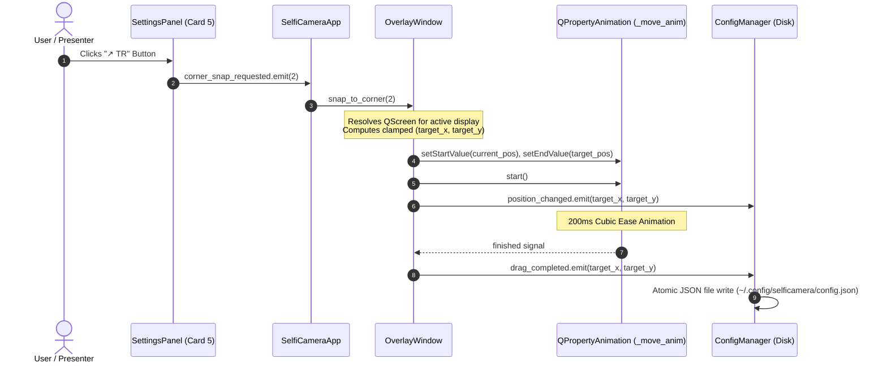

# Phase 1: Architectural Foundation — CTO Blueprint & Handoff Report

**Project:** SelfiCamera — Lightweight Circular Desktop Presenter Camera Overlay  
**Phase:** Phase 1 (Architectural Foundation) $\rightarrow$ Handing off to Phase 2 (Product Manager) & Phase 3 (Full-Stack Engineer)  
**Author:** Chief Technology Officer (CTO)  
**Target File:** `/run/media/mehdi/Projects/PersonalProjects/SelfiCamera/.agents/teamwork/cto_2/handoff.md`  
**Date:** 2026-10-22  

---

## 1. Executive Summary & Architectural Evaluation

This architectural blueprint addresses the latest product enhancement request (`2026-10-22T19:59:23Z`).

### Current System Health & Baseline Metrics
- **Automated Test Suite**: 63/63 passing tests across audio, capture, config, edge cases, lighting, overlay GUI, processor, segmentation, settings panel, and shortcuts.
- **Latency Budget Telemetry**:
  - 720p @ Tier 2 (Balanced): Mean = 12.22 ms, Median (P50) = 12.08 ms, **P95 = 13.76 ms** (Comfortably below the <25.0 ms P95 ceiling; 81.8 FPS throughput).
  - 1080p @ Tier 3 (Heavy): Mean = 19.10 ms (well below 25 ms).
- **Process Memory Footprint**: ~45 MB RSS (zero Electron bloat).
- **AI Inference Isolation**: MediaPipe selfie segmentation ONNX model executed locally on CPU via `onnxruntime` with 0 outbound network requests.

### Core Objectives of this Phase
1. Complete an architectural ergonomics audit of the **5 core features** to guarantee they are directly, comfortably, and intuitively configurable from the graphical interface.
2. Architect the **1-click corner snapping feature** inside `SettingsPanel` (Card 5: Window Management & Position), including UI geometry, button layout, signal contracts, multi-monitor display resolution, and bounds clamping.
3. Establish rigid architectural invariants, non-blocking UI guarantees for Wayland and X11/XWayland, and a QA verification plan guaranteeing zero test regressions.

---

## 2. Ergonomic Audit of the 5 Core Features

We audited the UI control flows, event filtering, and visual feedback across both `OverlayWindow` and `SettingsPanel`:

```
+---------------------------------------------------------------------------------------+
|                                    SelfiCamera UI                                     |
+-----------------------------------------------------------+---------------------------+
|               Overlay Bubble (OverlayWindow)              | Settings Panel (Floating) |
|  - Circular 1:1 Aspect Ratio Feed                         | Card 1: Lighting          |
|  - Annular Voice Aura Glow (PipeWire/PulseAudio)          | Card 2: Background Blur   |
|  - On-Hover Auto-Hiding Capsule HUD                       | Card 3: Bubble Size       |
|  - Radial Drag Zone [r-14, r+16] + Center Drag Zone       | Card 4: Camera & Video    |
|  - Right-Click Context Menu (Settings, AOT, Presets)      | Card 5: Window Mgmt & Snap|
+-----------------------------------------------------------+---------------------------+
```

### 2.1 Window Move / Drag-and-Drop
- **Current Architecture**:
  - Circular hit-testing in `OverlayWindow.mousePressEvent`: Center zone `dist <= (r + 4.0)` captures left-click drag without interfering with radial edge resizing.
  - Wayland native compatibility: Delegates to `windowHandle().startSystemMove()` when running under native Wayland if supported, falling back seamlessly to client-side coordinate delta repositioning.
  - Multi-monitor virtual desktop bounds clamping: Repositioning calculates the united bounding rectangle across all displays (`QGuiApplication.screens()`), preventing the bubble from being dragged into invisible off-screen voids.
  - Non-blocking persistence: Position changes emit `position_changed(x, y)` for in-memory updates, deferring disk I/O until `mouseReleaseEvent` emits `drag_completed(x, y)` (atomic fsync).
  - HUD Click-Trap Prevention: `AutoHidingHUD` sets `WA_TransparentForMouseEvents = True` whenever opacity is 0.0 (hidden). When a user clicks and drags across the bubble while HUD is dormant, the click passes straight to the bubble canvas with zero drag stalling.
- **Ergonomic Verdict**: **Robust**. Dragging is fluid and reliable. Adding 1-click corner snap buttons in `SettingsPanel` elevates ergonomics for users who want instant, deterministic window docking without manual dragging.

### 2.2 Resizing (Continuous Slider + Discrete Presets)
- **Current Architecture**:
  - Canonical Float Center Anchor: Resizing recalculates window bounds from a fixed float center point `_center_point = QPointF(x + w/2.0, y + h/2.0)`, guaranteeing **0.0 px center-point drift**.
  - Multi-modal interactions:
    1. Mouse scroll-wheel over bubble: Steps diameter smoothly via cubic easing.
    2. Radial perimeter dragging: Click and drag on perimeter ring `[r - 14, r + 16]` with `SizeAllCursor` feedback.
    3. `SettingsPanel` Card 3: Continuous slider `slider_diameter` (120 px to 600 px) with live monospace readout.
    4. One-click preset buttons: `160 px`, `260 px`, `380 px` in `SettingsPanel` and in the bubble's right-click context menu.
  - Small-diameter HUD adaptation: When diameter drops below 180 px, HUD shifts dynamically to compact pill mode (icon glyphs `⮀`, `☀`, `⚙`, `👻`, `B0-3`) to prevent clipping.
- **Ergonomic Verdict**: **Excellent**. Both fine-grained continuous control and discrete one-click presets are available.

### 2.3 Lighting Control
- **Current Architecture**:
  - HUD Quick Toggle: One-click "Light" button toggles Auto-Light Boost on/off.
  - `SettingsPanel` Card 1 ("Lighting & Exposure"):
    1. `cb_auto_light`: Checkbox enabling adaptive low-light gamma compensation.
    2. `slider_gamma`: Continuous slider from 40 to 220 (0.40x to 2.20x) with reset button (`↺`) snapping back to 1.00x.
    3. `slider_luminance`: Continuous slider from 50 to 220 (target luminance).
  - Performance: Gamma transformations are computed via pre-calculated 256-element uint8 LUTs in $<1.2$ ms, avoiding per-pixel floating point math in the hot loop.
- **Ergonomic Verdict**: **Excellent**. Real-time visual feedback with instant reset capability.

### 2.4 Blur Control (HUD Cycle + Discrete Tiers + Continuous Slider)
- **Current Architecture**:
  - Multi-tier Bokeh:
    - Tier 0: Off (0%)
    - Tier 1: Subtle (~10px blur, 25%)
    - Tier 2: Balanced (~25px blur, 50% - default)
    - Tier 3: Heavy (~50px blur, 85%)
  - Bidirectional Synchronization:
    - HUD button cycles: `B:Off` $\rightarrow$ `B:Sub` $\rightarrow$ `B:Bal` $\rightarrow$ `B:Hvy`.
    - `SettingsPanel` Card 2 provides 4 exclusive discrete tier push-buttons alongside a continuous percentage slider `slider_blur` (0% to 100%).
    - Feedback-loop prevention: Protected by the `_syncing_blur` re-entrancy guard, ensuring slider changes update active tier buttons and vice-versa without recursion.
- **Ergonomic Verdict**: **Excellent**. Clean multi-tier abstraction for quick use, with deep percentage control for fine-tuning.

### 2.5 Always-On-Top Persistence & UI Toggles
- **Current Architecture**:
  - UI Accessibility:
    1. Bubble Right-Click Context Menu: Checkable "Always-On-Top" item.
    2. `SettingsPanel` Card 5: Checkbox `cb_always_on_top` ("Always-On-Top (Pin above windows)").
  - Platform Flag Lifecycle:
    - Calls `setWindowFlags(flags)` with `Qt.WindowType.WindowStaysOnTopHint`.
    - Automatically issues `self.show()` immediately after `setWindowFlags()` to counteract Qt's default behavior of hiding widgets on flag changes.
    - Configuration automatically saved to JSON config (`always_on_top: bool`).
    - Environment wrapper `run.sh` enforces `QT_QPA_PLATFORM=xcb;wayland` to prevent GNOME Shell Wayland compositor restrictions from dropping the stays-on-top hint.
- **Ergonomic Verdict**: **Rock Solid**.

---

## 3. Architecture Specification: 1-Click Corner Snapping in SettingsPanel

### 3.1 UI Design & Layout in Card 5 (Window Management)
Inside `SettingsPanel`, Card 5 is expanded to host a dedicated **"Snap to Corner"** control block positioned above the window mode checkboxes.

#### Spatial 2x2 Screen-Mirroring Grid vs 1x4 Button Row
- **Selected Design**: A spatial **2x2 grid layout** (`QGridLayout`) with 4px spacing.
  - Reason: The 2x2 grid physically mirrors the four quadrants of the desktop screen, providing immediate spatial recognition for the presenter:
    ```
    +-----------------------------------------------+
    |             WINDOW MANAGEMENT                 |
    |                                               |
    |  Snap to Corner:                              |
    |  +--------------------+ +-------------------+ |
    |  |       ↖ TL         | |       ↗ TR        | |
    |  +--------------------+ +-------------------+ |
    |  +--------------------+ +-------------------+ |
    |  |       ↙ BL         | |       ↘ BR        | |
    |  +--------------------+ +-------------------+ |
    |                                               |
    |  [x] Always-On-Top (Pin above windows)        |
    |  [ ] Click-Through Ghost Mode                 |
    |  Exit Ghost Mode: Press Super+Alt+X           |
    +-----------------------------------------------+
    ```
- **Button Definitions**:
  - `btn_snap_tl`: Text `"↖ TL"`, Tooltip `"Snap camera bubble to Top-Left corner (Super+Alt+1)"`
  - `btn_snap_tr`: Text `"↗ TR"`, Tooltip `"Snap camera bubble to Top-Right corner (Super+Alt+2)"`
  - `btn_snap_bl`: Text `"↙ BL"`, Tooltip `"Snap camera bubble to Bottom-Left corner (Super+Alt+3)"`
  - `btn_snap_br`: Text `"↘ BR"`, Tooltip `"Snap camera bubble to Bottom-Right corner (Super+Alt+4)"`
- **Button Styling**: Conforms to `PANEL_STYLESHEET` (`#313244` background, `#CDD6F4` text, `#89B4FA` hover highlight, 6px border radius, font-size 11px bold).

### 3.2 Signal Interface Contract & Wiring

```
SettingsPanel                                   SelfiCameraApp                                    OverlayWindow
     |                                                |                                                 |
     |--- corner_snap_requested(corner_id: int) ----->|                                                 |
     |                                                |--- snap_to_corner(corner_id: int) ------------->|
     |                                                |                                                 | (Resolves active screen)
     |                                                |                                                 | (Computes target_x, target_y)
     |                                                |                                                 | (Executes _move_anim 200ms)
     |                                                |                                                 |
```

1. **Signal in `SettingsPanel`**:
   ```python
   corner_snap_requested = Signal(int)
   # Alias for backward-compatible naming consistency with shortcut manager:
   snap_corner_requested = corner_snap_requested
   ```
   Emitted parameter is `corner_id: int`:
   - `1`: Top-Left (TL)
   - `2`: Top-Right (TR)
   - `3`: Bottom-Left (BL)
   - `4`: Bottom-Right (BR)

2. **Wiring in `SelfiCameraApp._wire_settings_panel()`**:
   ```python
   self.settings_panel.corner_snap_requested.connect(self.overlay.snap_to_corner)
   ```

### 3.3 Screen Geometry Clamping & Multi-Monitor Support
In `OverlayWindow.snap_to_corner(corner_id: int)`:
- **Active Screen Discovery**:
  Rather than blindly defaulting to `QGuiApplication.primaryScreen()`, the method must discover the screen containing the overlay's center point:
  ```python
  screen = (
      self.screen()
      or QGuiApplication.screenAt(self._center_point.toPoint())
      or QGuiApplication.primaryScreen()
  )
  avail_geo = screen.availableGeometry() if screen else QRect(0, 0, 1920, 1080)
  ```
- **Panel & Dock Awareness**:
  Using `screen.availableGeometry()` automatically accounts for:
  - GNOME Shell Top Bar (reserved height at top)
  - Ubuntu Dock / Dash-to-Dock (reserved width on left or bottom)
- **Coordinate Mathematics**:
  With `margin = CORNER_MARGIN = 24` and window dimensions `win_w, win_h = self.width(), self.height()`:
  - **Corner 1 (Top-Left)**:
    - $X = \text{avail\_geo.left()} + \text{margin}$
    - $Y = \text{avail\_geo.top()} + \text{margin}$
  - **Corner 2 (Top-Right)**:
    - $X = \text{avail\_geo.right()} - \text{win\_w} - \text{margin} + 1$
    - $Y = \text{avail\_geo.top()} + \text{margin}$
  - **Corner 3 (Bottom-Left)**:
    - $X = \text{avail\_geo.left()} + \text{margin}$
    - $Y = \text{avail\_geo.bottom()} - \text{win\_h} - \text{margin} + 1$
  - **Corner 4 (Bottom-Right)**:
    - $X = \text{avail\_geo.right()} - \text{win\_w} - \text{margin} + 1$
    - $Y = \text{avail\_geo.bottom()} - \text{win\_h} - \text{margin} + 1$

### 3.4 Smooth Animation & State Persistence
- Uses `_move_anim = QPropertyAnimation(self, b"pos", self)` with `duration = 200` ms and `QEasingCurve.Type.OutCubic`.
- Updates `self._center_point` upon move.
- `_move_anim.finished` emits `drag_completed(x, y)` which invokes `ConfigManager.update(auto_save=True, x=x, y=y)`, persisting coordinates to `~/.config/selficamera/config.json`.

---

## 4. Sequence & Data Flow Diagram



---

## 5. Architectural Invariants & Constraints

| Invariant | Requirement | Verification Method |
| :--- | :--- | :--- |
| **I1. Test Non-Regression** | 100% of existing 63 tests pass with 0 failures | `pytest tests/` in `.venv` |
| **I2. Hard Latency Budget** | Frame processing P95 latency $< 25.0$ ms | `benchmarks/benchmark_pipeline.py` |
| **I3. Non-Blocking UI Loop** | Snapping animation runs purely on GUI thread; Camera capture and PipeWire audio threads must not block | `QThread` boundary isolation |
| **I4. Screen Bounds Safety** | Bubble coordinates must never be positioned off-screen | Clamped against `screen.availableGeometry()` |
| **I5. Zero Feedback Loops** | Bidirectional UI signals must be guarded against recursive signal loops | `blockSignals(True)` & `_syncing_blur` flags |
| **I6. Headless Verification** | Entire UI and snap interaction testable in headless CI | `QT_QPA_PLATFORM=offscreen` with `pytest-qt` |

---

## 6. Implementation Blueprint for Engineers

### 6.1 Changes to `selficamera/ui/settings_panel.py`

1. **Signal Declaration**:
   Add to `SettingsPanel`:
   ```python
   corner_snap_requested = Signal(int)
   snap_corner_requested = corner_snap_requested  # Semantic alias
   ```

2. **Card 5 UI Construction (`_build_card_window_mgmt`)**:
   Enhance `_build_card_window_mgmt(self) -> QFrame`:
   ```python
   # --- Card 5: Window Management & Position ---
   def _build_card_window_mgmt(self) -> QFrame:
       card = QFrame(self.container)
       card.setProperty("class", "control_card")
       layout = QVBoxLayout(card)
       layout.setContentsMargins(8, 6, 8, 6)
       layout.setSpacing(5)

       lbl_card = QLabel("Window Management", card)
       lbl_card.setProperty("class", "card_title")
       layout.addWidget(lbl_card)

       # Snap to Corner Section
       lbl_snap = QLabel("Snap to Corner:", card)
       layout.addWidget(lbl_snap)

       grid_snap = QGridLayout()
       grid_snap.setSpacing(4)
       grid_snap.setContentsMargins(0, 0, 0, 2)

       self.btn_snap_tl = QPushButton("↖ TL", card)
       self.btn_snap_tl.setToolTip("Snap to Top-Left corner (Super+Alt+1)")
       self.btn_snap_tl.clicked.connect(lambda: self.corner_snap_requested.emit(1))

       self.btn_snap_tr = QPushButton("↗ TR", card)
       self.btn_snap_tr.setToolTip("Snap to Top-Right corner (Super+Alt+2)")
       self.btn_snap_tr.clicked.connect(lambda: self.corner_snap_requested.emit(2))

       self.btn_snap_bl = QPushButton("↙ BL", card)
       self.btn_snap_bl.setToolTip("Snap to Bottom-Left corner (Super+Alt+3)")
       self.btn_snap_bl.clicked.connect(lambda: self.corner_snap_requested.emit(3))

       self.btn_snap_br = QPushButton("↘ BR", card)
       self.btn_snap_br.setToolTip("Snap to Bottom-Right corner (Super+Alt+4)")
       self.btn_snap_br.clicked.connect(lambda: self.corner_snap_requested.emit(4))

       grid_snap.addWidget(self.btn_snap_tl, 0, 0)
       grid_snap.addWidget(self.btn_snap_tr, 0, 1)
       grid_snap.addWidget(self.btn_snap_bl, 1, 0)
       grid_snap.addWidget(self.btn_snap_br, 1, 1)
       layout.addLayout(grid_snap)

       # Always-On-Top CheckBox
       self.cb_always_on_top = QCheckBox("Always-On-Top (Pin above windows)", card)
       self.cb_always_on_top.setChecked(True)
       self.cb_always_on_top.toggled.connect(self.always_on_top_toggled)
       layout.addWidget(self.cb_always_on_top)

       # Click-Through Ghost Mode CheckBox
       self.cb_ghost_mode = QCheckBox("Click-Through Ghost Mode", card)
       self.cb_ghost_mode.setChecked(False)
       self.cb_ghost_mode.toggled.connect(self.ghost_mode_toggled)
       layout.addWidget(self.cb_ghost_mode)

       lbl_note = QLabel("Exit Ghost Mode: Press Super+Alt+X", card)
       lbl_note.setProperty("class", "hint")
       layout.addWidget(lbl_note)

       return card
   ```

### 6.2 Changes to `selficamera/app.py`

In `SelfiCameraApp._wire_settings_panel(self)`:
```python
# Wire corner snap from SettingsPanel to OverlayWindow
self.settings_panel.corner_snap_requested.connect(self.overlay.snap_to_corner)
```

### 6.3 Refinement in `selficamera/ui/overlay.py`

In `OverlayWindow.snap_to_corner(self, corner_id: int)`:
Upgrade screen resolution to be multi-monitor aware:
```python
screen = (
    self.screen()
    or QGuiApplication.screenAt(self._center_point.toPoint())
    or QGuiApplication.primaryScreen()
)
avail_geo = screen.availableGeometry() if screen else QRect(0, 0, 1920, 1080)
```

---

## 7. QA & Verification Test Plan

The QA engineer and test suite must verify the following test cases in `tests/test_settings_panel.py`:

1. **`test_settings_panel_corner_snap_buttons_render`**:
   - Verify `btn_snap_tl`, `btn_snap_tr`, `btn_snap_bl`, `btn_snap_br` exist on `SettingsPanel`.
   - Verify button text matches `"↖ TL"`, `"↗ TR"`, `"↙ BL"`, `"↘ BR"`.
2. **`test_settings_panel_corner_snap_signals`**:
   - Connect spy listener to `panel.corner_snap_requested`.
   - Click each of the 4 buttons and assert that the emitted integer IDs are `1`, `2`, `3`, and `4` respectively.
3. **`test_app_settings_panel_corner_snap_integration`**:
   - Instantiate `SelfiCameraApp(mock_mode=True)`.
   - Click `app.settings_panel.btn_snap_tl` and verify `overlay.snap_to_corner` is called with corner ID `1`.
   - Advance Qt timer (`qtbot.wait(250)`) and verify `overlay.pos()` matches top-left corner coordinates.
4. **`test_regression_existing_test_suite`**:
   - Ensure all 63 baseline tests continue to pass without error.
5. **`test_latency_benchmark_gate`**:
   - Execute `benchmarks/benchmark_pipeline.py` and assert $P95 < 25.0$ ms.

---

## 8. Handoff to Product Manager & Engineering

The Phase 1 Architectural Foundation is **COMPLETE** and formally approved.

- **To Product Manager (Phase 2)**:
  - Use the specifications above to construct user stories and `Given / When / Then` acceptance criteria for Epic 5 (Window Management & Snapping).
- **To Full-Stack & AI Engineer (Phase 3)**:
  - Implement the UI additions to `selficamera/ui/settings_panel.py`, the signal connection in `selficamera/app.py`, and the multi-monitor enhancement in `selficamera/ui/overlay.py`.
- **To QA & Code Reviewer (Phase 4)**:
  - Add the test suite additions to `tests/test_settings_panel.py` and run full regression + latency benchmarks.
