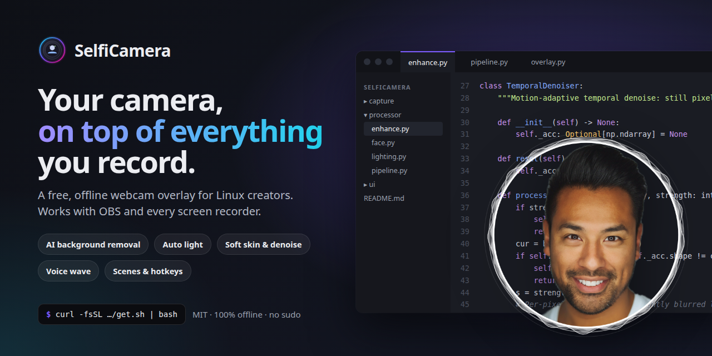
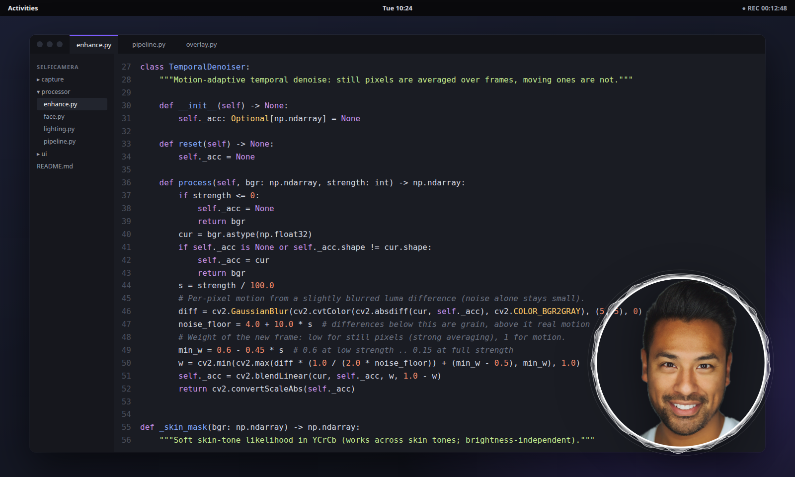
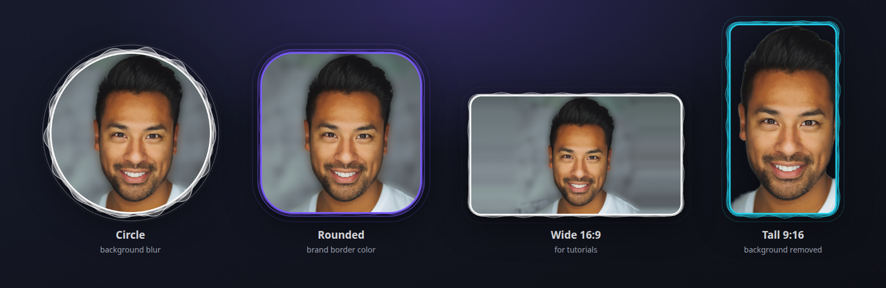
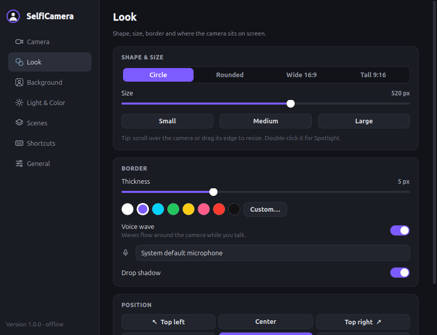
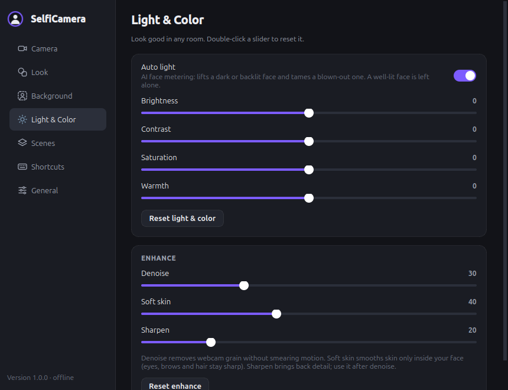

<p align="center">
  
</p>

<h1 align="center">SelfiCamera</h1>

<p align="center">
  <b>A free, offline webcam overlay for Linux creators.</b><br>
  Put a shaped, branded camera bubble over VS Code, Blender, slides or a browser,<br>
  then record it all with OBS or any screen recorder.
</p>

<p align="center">
  <a href="https://github.com/mgmehdiforme/SelfiCamera/actions/workflows/tests.yml"></a>
  <a href="LICENSE"></a>
  
  
  
</p>

<p align="center">
  <a href="#-install">Install</a> ·
  <a href="#-features">Features</a> ·
  <a href="#-use-it">Use it</a> ·
  <a href="#-command-line-and-automation">Automation</a> ·
  <a href="#-recording-tips">Recording tips</a> ·
  <a href="#-faq">FAQ</a> ·
  <a href="#-contributing">Contributing</a>
</p>

---

Loom-style camera bubbles have been a Mac and Windows thing. **SelfiCamera brings them to Linux**,
with an AI background cut-out, auto light that meters on your face and a voice wave that moves
while you talk. Everything runs on your CPU. No account, no cloud, no watermark, no telemetry.

<p align="center">
  
</p>

## ⚡ Install

One command. No sudo, nothing installed system-wide:

```bash
curl -fsSL https://raw.githubusercontent.com/mgmehdiforme/SelfiCamera/main/get.sh | bash
```

Then open **SelfiCamera** from your app menu, or run `selficamera`.

If your system is missing a library, the installer ends with the exact `sudo apt install …` line
to run (check again any time with `selficamera --check-system`). On a fresh Ubuntu it is:

```bash
sudo apt install libxcb-cursor0 libxkbcommon-x11-0 libxcb-icccm4 libxcb-keysyms1 libxcb-xkb1 libportaudio2
```

**Update:** run the install command again.
**Uninstall:** `bash ~/.local/share/selficamera/app/uninstall.sh` (add `--purge` to also delete settings and models).

<details>
<summary><b>What the installer does, and its options</b></summary>

- downloads SelfiCamera to `~/.local/share/selficamera/app`,
- builds an isolated Python 3.12 environment with [uv](https://docs.astral.sh/uv/) (installed to `~/.local/bin` if you don't have it),
- downloads the two offline AI models once (~480 KB),
- adds SelfiCamera to your app menu and the `selficamera` command to `~/.local/bin`.

Add options after `bash -s --`, for example `curl -fsSL …/get.sh | bash -s -- --with-shortcuts --autostart`:

| Option | What it does |
|---|---|
| `--with-shortcuts` | Registers the global shortcuts below as GNOME custom shortcuts. |
| `--autostart` | Starts SelfiCamera when you log in. |

</details>

<details>
<summary><b>Install from a git checkout instead</b></summary>

```bash
git clone https://github.com/mgmehdiforme/SelfiCamera.git && cd SelfiCamera
bash install.sh --with-model --with-shortcuts
```

`install.sh` points the launcher at this checkout. You can also run it without installing: `bash run.sh`.

</details>

Works on Ubuntu and other Linux desktops: GNOME (Wayland, through XWayland) and X11.

## ✨ Features

<p align="center">
  
</p>

| | |
|---|---|
| 🟣 **Shapes** | Circle, rounded square, wide 16:9 and tall 9:16 for Shorts and Reels. |
| 🪄 **AI background** | Blur, a solid color (chroma green for editing), your own image, or **remove** it so only you float over the screen. |
| 💡 **Auto light** | An AI face detector meters on *your face*: it lifts a dark or backlit face, tames a washed-out one and leaves good light alone. |
| ✨ **Enhance** | Denoise removes webcam grain without smearing motion. Soft skin smooths skin only inside your face (eyes, brows and hair stay sharp). Sharpen brings back detail. |
| 🎯 **Framing** | Zoom, pan and **auto-frame**, which follows you and keeps your head in the upper third. |
| 🌊 **Voice wave** | Waves flow around the camera while you talk, in your border color. |
| 🔦 **Spotlight** | One key grows the camera to the center for intros and outros; the same key sends it back. |
| 🎬 **Scenes** | Save looks like "Intro" or "Tutorial corner" and switch with a click, the tray or a hotkey. |
| 🧼 **Clean recordings** | Controls only on hover (or never). No windows pop up on their own, and Quit is never on the camera. |
| 🔒 **Private** | No network access at runtime and no telemetry. A test in CI proves it. |

<table>
  <tr>
    <td width="50%"></td>
    <td width="50%"></td>
  </tr>
  <tr>
    <td align="center"><sub>Shape, size, border color and voice wave</sub></td>
    <td align="center"><sub>Auto light, color and Enhance</sub></td>
  </tr>
</table>

### How it stays fast

Each frame is processed at the bubble's on-screen size on a worker thread, so even with
background removal, auto light, denoise, soft skin and sharpen all on, a frame takes
**under 15 ms (p95)** on a laptop CPU. The budget is 20 ms, and a benchmark in the repo checks it.

| AI model | Used for | Size | License |
|---|---|---|---|
| Google MediaPipe Selfie Segmenter | background blur, replace, remove | ~250 KB | Apache-2.0 |
| OpenCV YuNet face detector | auto light, soft skin | ~230 KB | MIT |

Both are downloaded once by the installer and then run offline. We tested heavier AI face
restoration and low-light models (GFPGAN, CodeFormer, GPEN, Zero-DCE++, SCI, IAT) and left them
out: too slow for live video, flicker between frames, or licenses that forbid commercial use.
Details are in [docs/PRODUCT.md](docs/PRODUCT.md).

## 🎥 Use it

- **Move:** drag the camera. **Resize:** scroll over it or drag its edge.
- **Hover** for quick controls: Background, Mirror, Spotlight, Settings, Hide.
- **Double-click** for Spotlight. **Right-click** for everything else, including Quit.
- **Tray icon:** click to show or hide; the menu has every quick action.

### Global shortcuts

| Keys | Action |
|---|---|
| `Super+Alt+C` | Show / hide camera |
| `Super+Alt+Z` | Spotlight (big and centered) |
| `Super+Alt+B` | Next background effect |
| `Super+Alt+M` | Mirror |
| `Super+Alt+X` | Click-through on / off |
| `Super+Alt+O` | Settings |
| `Super+Alt+1…4` / `5` | Snap to a corner / center |

On X11 these work right away. On GNOME Wayland, install them once from Settings → Shortcuts
or with `selficamera --install-shortcuts`.

## 🤖 Command line and automation

Every action works from a terminal, so you can drive SelfiCamera from a Stream Deck, OBS
scripts or your own hotkeys. Commands reach the running app in a fraction of a second.

```bash
selficamera --scene "Intro"                   # apply a saved scene
selficamera --spotlight                       # toggle spotlight
selficamera --set background_mode=blur --set blur_strength=70
selficamera --set shape=portrait --set size=320
selficamera --set soft_skin=50 --set denoise=60
selficamera --snap 4                          # 1 TL, 2 TR, 3 BL, 4 BR, 5 center
selficamera --status                          # current state as JSON
selficamera --exit
```

Startup options: `--device /dev/video2`, `--width 1920 --height 1080`, `--fps 60`, `--shape`,
`--background`, `--size`, `--no-mirror`, `--ghost`, `--demo` (synthetic camera, no hardware),
`--config PATH`, `--debug`. See `selficamera --help`.

## 🎬 Recording tips

- **OBS:** add a *Screen Capture (PipeWire)* source. The camera is part of the screen, so it's recorded too.
- **Clean look:** Settings → General → turn off *Show controls on hover*. Right-click still works.
- **Cut-out presenter:** Background → *Remove*, Border → *Off*, Drop shadow off.
- **Cheap or grainy webcam:** Light & Color → Enhance: Denoise 50–70, then Sharpen 20–40.
  Add Soft skin 30–60 for a rested look.
- **Chroma key in your editor:** Background → *Color* → green (`#00B140`).
- **Intro to tutorial:** save a big centered scene "Intro" and a small corner scene "Tutorial",
  then switch with `selficamera --scene Tutorial`, or press `Super+Alt+Z` for Spotlight.

## ❓ FAQ

<details>
<summary><b>Why does it need those apt libraries?</b></summary>

GNOME on Wayland only lets apps stay on top and position themselves when they run through
XWayland, and Qt's X11 mode needs these libraries. Without them SelfiCamera still runs, but in
*limited mode*: it can't stay on top or snap to corners, and it tells you so.
</details>

<details>
<summary><b>I see a box or shadow around the round camera.</b></summary>

Some GNOME extensions (such as *Rounded Window Corners*) draw a shadow around every window.
SelfiCamera adds itself to their exclusion list automatically. If you still see a box, restart
the extension or log out and back in.
</details>

<details>
<summary><b>Does it send my video anywhere?</b></summary>

No. SelfiCamera makes no network connections while it runs; `benchmarks/network_privacy_audit.py`
checks this on every commit. The only downloads are the two models, once, by the installer.
</details>

<details>
<summary><b>Where are my settings and logs?</b></summary>

| What | Where |
|---|---|
| Settings | `~/.config/selficamera/config.json` |
| Log | `~/.local/state/selficamera/selficamera.log` |
| AI models | `~/.local/share/selficamera/models/` |

Custom ONNX segmentation models with a `[1,256,256,3] → [1,256,256,1]` signature also work: drop
`selfie_segmenter.onnx` in the models folder or point `SELFICAMERA_MODEL` at the file.
</details>

## 🛠 Contributing

Bug reports, ideas and pull requests are welcome. Please open an
[issue](https://github.com/mgmehdiforme/SelfiCamera/issues) first for bigger changes.

```bash
bash run.sh --demo                                     # run from source with a synthetic camera
.venv/bin/pip install -r requirements-dev.txt
.venv/bin/python -m pytest                             # 130+ tests, headless, no camera needed
.venv/bin/python benchmarks/benchmark_pipeline.py      # per-frame latency (budget: p95 ≤ 20 ms)
.venv/bin/python benchmarks/network_privacy_audit.py   # proves no network access at runtime
```

**Architecture.** `capture/camera.py` captures *and processes* frames on a worker thread and
hands the GUI only the newest frame. `processor/` does framing, light and color, enhance,
segmentation and background compositing at the bubble's on-screen size. `app.py` is the one
place where settings are validated, applied and saved. `ui/` holds the bubble, voice wave, hover
controls, settings window and tray. `desktop.py` handles GNOME shortcuts, autostart, system
checks and model downloads. The product spec is [docs/PRODUCT.md](docs/PRODUCT.md).

If SelfiCamera helps your videos, a ⭐ on GitHub helps other Linux creators find it.

## 📄 License

[MIT](LICENSE). The AI models, Google's MediaPipe Selfie Segmenter (Apache-2.0) and OpenCV's
YuNet face detector (MIT), are downloaded on request.

<sub>The person in the screenshots is a free stock photo from [Unsplash](https://unsplash.com/license),
shown through SelfiCamera's real rendering pipeline.</sub>
